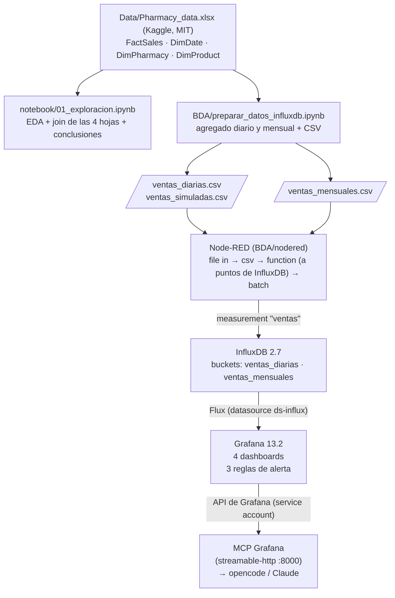

# Pharmacy Sales Big Data

Plataforma de análisis y monitorización de ventas para una cadena de **120 farmacias en 8 países europeos**, que quiere decidir **qué vender, dónde y si compensa promocionar**. Parte de 62.139 ventas de 2024-2025 (unidades, ingresos, coste, margen y promoción) y las convierte en un sistema que se opera de forma continua.

El proyecto tiene tres partes:

| Parte | Qué se ha hecho | Herramientas |
|---|---|---|
| **SBD** | Análisis exploratorio e informe para el cliente con tres preguntas de negocio | Jupyter, pandas |
| **BDA** | Plataforma de ingesta, almacenamiento, dashboards y alertas | Node-RED, InfluxDB, Grafana, Docker |
| **MIA** | Propuesta de modelo de IA para predecir el margen | Comparativa de modelos |

## Preguntas de negocio

1. ¿Qué países y categorías generan más ingresos y mejor margen?
2. ¿Cómo evolucionan las ventas mes a mes? ¿Hay estacionalidad?
3. ¿Las promociones aumentan las unidades vendidas o solo reducen el margen?

## Arquitectura



## Modelo de datos

El Excel es un esquema en estrella: `FactSales` (las ventas) y las dimensiones `DimDate`, `DimPharmacy` y `DimProduct`. El notebook de preparación las une y **agrega por día (y por mes)** antes de cargar. En InfluxDB, dos puntos con la misma medición, tags y fecha se sobrescriben, así que cargar las ventas una a una perdería datos.

Cada fila de los CSV es un punto de InfluxDB en la medición `ventas`:

| Tipo | Columnas |
|---|---|
| Fecha | `Fecha` (día en `ventas_diarias`, primer día del mes en `ventas_mensuales`) |
| Tags | `Country`, `Category`, `PromoFlag` |
| Fields | `ventas`, `unidades`, `ingresos_eur`, `costes_eur`, `margen_eur` |

El notebook termina con tres comprobaciones: sin duplicados, sin nulos y con el total de ingresos igual al del Excel original.

## Dashboards y alertas

| Dashboard | Paneles | Responde a |
|---|---|---|
| Evolución mensual | Ingreso mensual, ingreso total y tabla mensual 2024-2025 | Evolución y estacionalidad |
| Países y categorías | Ingresos por país, % de ingresos y beneficio por categoría | Dónde y qué vender |
| Promociones | Margen con y sin promoción, margen en ventas con promoción | Si compensan las promociones |
| Rentabilidad y crecimiento | Crecimiento 2025 vs 2024 por país y categoría, margen cedido por promociones | Dónde se crece y cuánto margen se regala |

Las tres alertas se evalúan cada minuto y avisan por email:

| Alerta | Se dispara si |
|---|---|
| Margen % en promoción (últimos 30 días) | < 15 % |
| Ingresos del mes anterior | < 350.000 € |
| Crecimiento de ingresos por país (12 meses vs 12 anteriores) | < 0 % |

Para probarlas está `ventas_simuladas.csv`: copia 2025 en 2026 con ruido y dos anomalías provocadas (16 días con un 40 % menos de ventas y 10 días con bajada de precio). Va al bucket `ventas_diarias`, pero los dashboards solo consultan 2024-2025, así que **los datos simulados solo los ven las alertas**.

El **MCP de Grafana** expone dashboards y datos en modo solo lectura para consultarlos en lenguaje natural desde opencode (`opencode.json`).

## Resultados principales

- **Países:** el margen % apenas varía entre países (27,8-28,2 %). Las diferencias vienen del volumen por farmacia: lideran Bélgica y Países Bajos, y Polonia queda un 39 % por debajo.
- **Categorías:** *Prescription* es el 32,4 % de los ingresos pero tiene el margen más bajo (21,9 %). *Wellness* y *Personal Care* rondan el 33,5 % de margen.
- **Evolución:** los ingresos pasan de 4,22 M€ (2024) a 4,41 M€ (2025), un **+4,4 %**. No hay una estacionalidad estable entre años.
- **Promociones:** no aumentan las unidades por venta (7,02 frente a 7,19) y bajan el margen del **29,0 % al 19,9 %**. Son el 12 % de las ventas pero solo el 7,5 % del margen. **Recomendación:** reducirlas o rediseñarlas, empezando por *Prescription*.

El detalle está en `SBD/Informe_cliente_farmacia.docx`.

## Puesta en marcha

### Requisitos

- **Docker** con **Docker Compose v2** (`docker compose version`). En Windows, Docker Desktop.
- **Bash** para `deploy.sh`: en Windows, ejecútalo desde **WSL** o **Git Bash**. En PowerShell no funciona.

### 1. Clonar y configurar

```bash
git clone https://github.com/ai-somorrostro/pharmacy-sales-bigdata.git
cd pharmacy-sales-bigdata
cp .env.example .env
```

Edita `.env` y rellena:

| Variable | Qué poner |
|---|---|
| `INFLUX_ADMIN_PASSWORD`, `GRAFANA_ADMIN_PASSWORD` | Contraseñas de tu elección (InfluxDB pide mínimo 8 caracteres) |
| `INFLUX_ADMIN_TOKEN` | Un texto largo y aleatorio. Para generarlo: `openssl rand -base64 64 \| tr -d '\n'` |
| `SMTP_USER`, `SMTP_PASSWORD` | Cuenta de Gmail y una *contraseña de aplicación* para enviar las alertas |
| `ALERT_EMAIL` | Quién recibe las alertas (vacío = `SMTP_USER`) |

Deja vacíos `INFLUX_READ_TOKEN`, `INFLUX_WRITE_TOKEN`, `GRAFANA_MCP_TOKEN` y `MCP_GRAFANA_SERVER_TOKEN`: se generan en el paso 2.

### 2. Levantar la plataforma

```bash
./deploy.sh up             # levanta InfluxDB, Grafana y Node-RED
./deploy.sh influx-tokens  # crea los tokens de lectura (Grafana) y escritura (Node-RED)
./deploy.sh mcp-token      # crea el service account de Grafana y arranca el MCP
```

Los dos últimos solo hacen falta la primera vez: guardan los tokens en `.env` y reinician los servicios que los usan. Comprueba que todo está arriba con `docker compose ps`.

### 3. Cargar los datos

1. Abre [Node-RED](http://127.0.0.1:1881).
2. En la pestaña *Flujo 1*, pulsa el botón del nodo *inject* de cada flujo: *Ventas Diarias CSV*, *Ventas Mensuales CSV* y *Ventas simuladas CSV*.
3. Los CSV ya están en `BDA/`, así que no hace falta ejecutar ningún notebook antes.

### 4. Ver los dashboards

Entra en [Grafana](http://127.0.0.1:3000) con `GRAFANA_ADMIN_USER` / `GRAFANA_ADMIN_PASSWORD`. Los 4 dashboards y las 3 alertas ya están cargados.

| Servicio | URL | Acceso |
|---|---|---|
| InfluxDB | http://127.0.0.1:8087 | `INFLUX_ADMIN_USER` / `INFLUX_ADMIN_PASSWORD` |
| Grafana | http://127.0.0.1:3000 | `GRAFANA_ADMIN_USER` / `GRAFANA_ADMIN_PASSWORD` |
| Node-RED | http://127.0.0.1:1881 | Sin autenticación (solo local) |
| MCP Grafana | http://127.0.0.1:8000/mcp | `MCP_GRAFANA_SERVER_TOKEN` (opencode lo lee de `mcp-token.txt`) |

Todos los puertos se publican solo en `localhost`.

### Parar y empezar de cero

```bash
./deploy.sh down    # para los contenedores y conserva los datos
./deploy.sh clean   # borra contenedores y volúmenes (pide confirmación)
```

Después de un `clean` hay que repetir los pasos 2 y 3. Los cambios en `INFLUX_ORG`, `INFLUX_ADMIN_*` o `GRAFANA_ADMIN_PASSWORD` solo se aplican al crear los volúmenes, así que también necesitan un `clean`.

### Decisiones de despliegue

- El `flows.json` del repositorio se copia a Node-RED en cada arranque. Los cambios hechos en el editor hay que exportarlos a `BDA/nodered/flows.json`.
- La URL, la organización y el token de Node-RED salen del `.env`; no hay que escribirlos en el editor.
- Los buckets `ventas_diarias` y `ventas_mensuales` tienen nombres fijos porque los usan los dashboards, las alertas y los flujos.

## Notebooks

```bash
python -m venv .venv && .venv\Scripts\activate    # Linux/WSL: source .venv/bin/activate
pip install -r requirements.txt
jupyter lab
```

| Notebook | Contenido |
|---|---|
| `notebook/01_exploracion.ipynb` | Análisis exploratorio, unión de las 4 hojas y respuesta a las preguntas de negocio |
| `notebook/analisis_productos_farmacias_detallado.ipynb` | Análisis por producto y categoría |
| `BDA/preparar_datos_influxdb.ipynb` | Agregados y CSV para InfluxDB (ya versionados en `BDA/`) |

## Documentación entregable

| Parte | Archivo |
|---|---|
| SBD | `SBD/Informe_cliente_farmacia.docx` |
| BDA | `BDA/BDA_AimarMora.pdf` |
| MIA | `MIA/MIA_farmacia.docx` |

## Limitaciones

- No hay datos de clientes, stock, tráfico ni competencia: el análisis de promociones mide unidades por venta, no clientes atraídos.
- `ventas_simuladas.csv` es una proyección estadística, no datos reales.

## Licencia y autor

Código con fines académicos. Dataset *European Pharmacy Sales* (Kaggle), licencia MIT.

**Aimar Mora**
